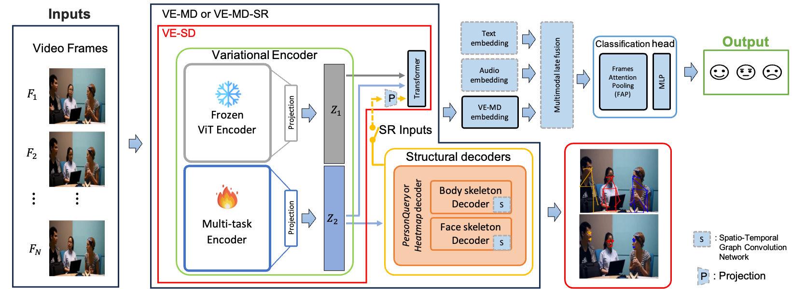
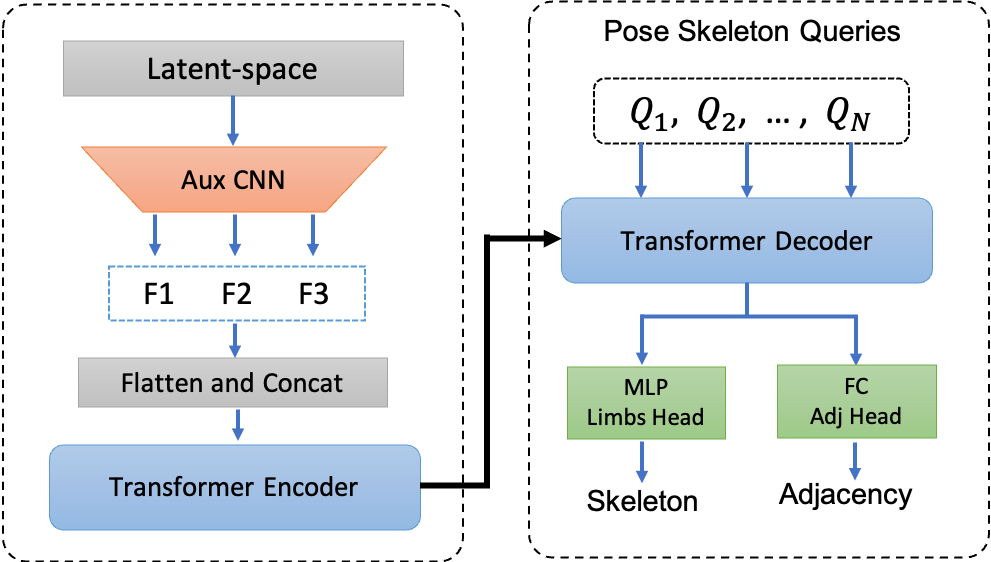
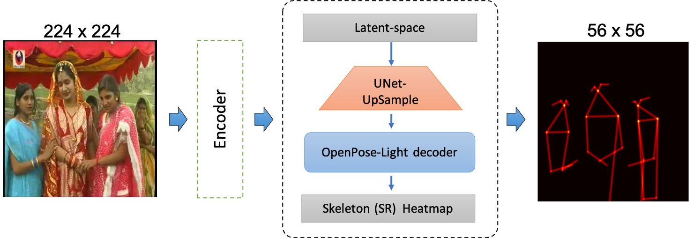
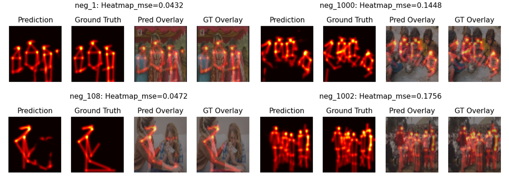
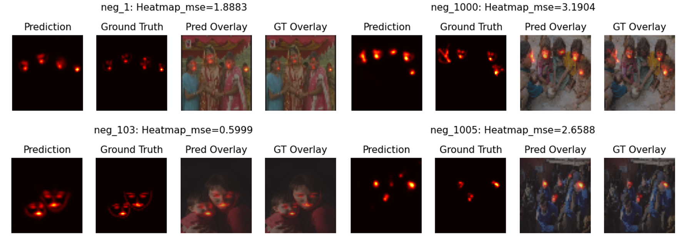
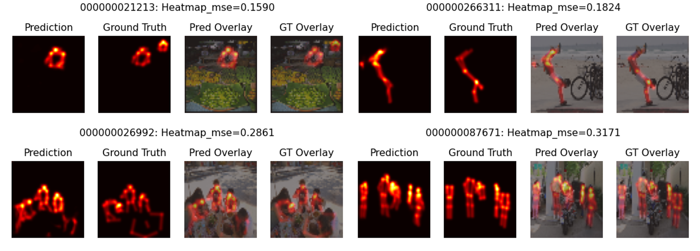
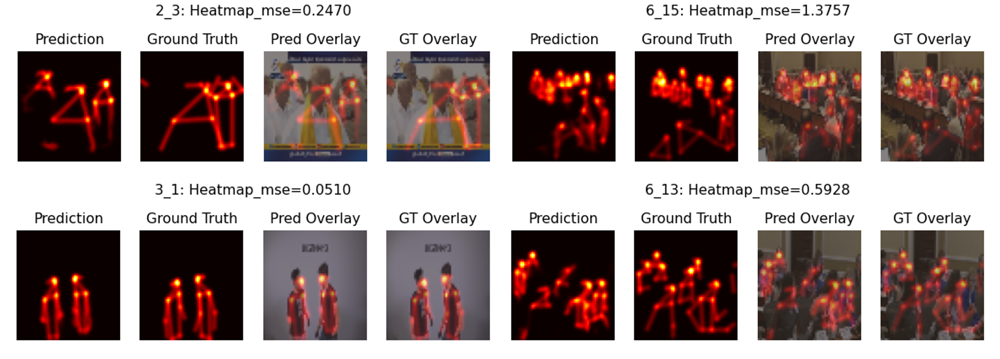

# VE-MD: Variational Encoder–Multi-Decoder

**Structural supervision for group and individual emotion recognition.**


VE-MD learns a shared latent representation for emotion classification and the prediction of body and facial structural representations (SR). This repository provides data preparation, training and validation for two variants:

- **VE-MD-PersonQuery:** a DETR-based decoder that predicts a set of structural representations.
- **VE-MD-Heatmap:** a dense decoder that predicts body and facial limb heatmaps.

Both variants combine a trainable visual encoder with **ViT features extracted in advance**. Each training run uses one dataset, with emotion classification and structural supervision optimized together.


[Overview](#method-overview) · [Data preparation](#data-preparation) · [Training](#training) · [Validation and outputs](#validation-and-outputs) · [Qualitative results](#qualitative-results) · [Inference](#audiovisual-inference)

## Method overview

The visual encoder operates on RGB frames. A frozen ViT extracts one feature vector per frame during preprocessing; training loads these cached features and learns their projection into the latent space. ViT feature extraction is therefore separate from both training implementations.

Structural decoders provide auxiliary supervision. The emotion classifier can use the latent representation alone or combine it with **predicted** structural features. Ground-truth skeletons and heatmaps are training targets, not inputs to the emotion classifier.

Training combines classification cross-entropy, structural prediction losses and maximum mean discrepancy (MMD) regularization of the latent representation.

For group emotion recognition, the functional design targets a group-level decision without identity tracking or per-person emotion classification. This architectural choice does not provide a formal anonymization guarantee.

<p align="center">
  
</p>

### PersonQuery decoder

The query-based decoder predicts a fixed-size set of structural representations. PersonQuery also supports optional ST-GCN processing of the predicted structures.

<p align="center">
  
</p>

### Heatmap decoder

The dense decoder represents structures with limb heatmaps and accommodates variable numbers of people without assigning one query to each person.

<p align="center">
  
</p>

## Repository organization

| Directory | Contents |
|---|---|
| [`data_preprocessing/`](data_preprocessing/README.md) | Frame sampling, ViT feature extraction, structural annotation and training data lists |
| [`VE_MD_detr/`](VE_MD_detr/README.md) | PersonQuery model, training, validation and configuration |
| [`VE_MD_heatmap/`](VE_MD_heatmap/README.md) | Heatmap model, training, validation and configuration |
| `images/` | Architecture figures, qualitative predictions and recorded demonstrations |

Preprocessing is kept separate from the two model directories. Both model directories follow the same structure:

| File | Purpose |
|---|---|
| `run.py` | Load configuration, select the device and run training or evaluation |
| `train.py` | Train for one epoch |
| `validation.py` | Compute classification loss, accuracy and macro-F1 |
| `model.py`, `encoders.py`, `decoders.py` | Define the model and its components |
| `loss.py` | Combine classification, structural and latent regularization losses |
| `dataset.py` | Read the prepared samples and form batches |
| `config.yaml` | Set data paths, model options and training parameters |

## Data preparation

Follow the [preprocessing guide](data_preprocessing/README.md) for installation, external annotation models and complete commands.

1. Create a CSV for each split with columns `id,path,label`. Labels must be integers from `0` to `num_classes - 1`, using the same class order across splits.
2. Sample and save RGB frames with `extract_frames.py`. Use one frame for images and the experiment's sampling protocol for videos.
3. Extract cached ViT features with `extract_features.py`, using the checkpoint and normalization required by the experiment.
4. Extract body and/or facial annotations for training, then run `prepare_targets.py` to create PersonQuery targets and heatmaps.
5. Run `make_manifest.py` to create the JSON data lists consumed by the training code.

All representations must refer to the same sampled frames in the same order. Classification validation requires frames, labels and ViT features when enabled; structural targets are unnecessary.

After the extraction stages, run the following **from `data_preprocessing/`**:

```bash
python make_manifest.py --index prepared/train/frames.json \
  --features prepared/train/features --targets prepared/train/targets \
  --output prepared/train

python make_manifest.py --index prepared/val/frames.json \
  --features prepared/val/features --output prepared/val
```

Each split receives a `personquery.json` and a `heatmap.json`. These lists are ready to use; no additional conversion with the training directories' `tools/prepare_data.py` is needed. That adapter is available for supported existing data layouts.

### JSON data format

Each JSON file contains a list of sample records. Paths inside a record are relative to the JSON file. `images.path` identifies the HDF5 file and `images.key` identifies the sample within it.

The filenames are configurable: files named `train.json`, `val.json` or `validation.json` use the same format. The preprocessing tools retain the variant names shown below.

**PersonQuery training — `prepared/train/personquery.json`:**

```json
[
  {
    "id": "clip001",
    "label": 0,
    "images": {
      "path": "frames.h5",
      "key": "clip001"
    },
    "feat_vit": "features/clip001.vit_feat.pt",
    "skeleton_person": "targets/clip001_person_kp.pt",
    "adjacency_person": "targets/clip001_person_adj.pt",
    "skeleton_face": "targets/clip001_face_kp.pt",
    "adjacency_face": "targets/clip001_face_adj.pt"
  }
]
```

**Heatmap training — `prepared/train/heatmap.json`:**

```json
[
  {
    "id": "clip001",
    "label": 0,
    "images": {
      "path": "frames.h5",
      "key": "clip001"
    },
    "feat_vit": "features/clip001.vit_feat.pt",
    "limb_person": "targets/clip001_person_limb.pt",
    "limb_face": "targets/clip001_face_limb.pt"
  }
]
```

These examples include both body and face supervision. Enable the corresponding branches in `config.yaml`; when preparing only one branch, the other branch's target fields are omitted.

**Classification validation — `prepared/val/personquery.json` or `prepared/val/heatmap.json`:**

```json
[
  {
    "id": "clip101",
    "label": 2,
    "images": {
      "path": "frames.h5",
      "key": "clip101"
    },
    "feat_vit": "features/clip101.vit_feat.pt"
  }
]
```

Here, `frames.h5` belongs to the validation directory. Sample identifiers and labels are illustrative; apply the dataset's actual class mapping.

| Prepared data | Shape per sample |
|---|---|
| RGB frames in HDF5 | `(T, H, W, 3)`, uint8 |
| Cached ViT features | `(T, D)`, normally `D = 1024` |
| PersonQuery body / face coordinates | List of `T` tensors: `(N_t, 72)` / `(N_t, 80)` |
| PersonQuery body / face adjacency | List of `T` tensors: `(N_t, 18, 18)` / `(N_t, 20, 20)` |
| Body / face heatmaps | `(T, 18, 56, 56)` / `(T, 83, 56, 56)` |

`T` is the number of frames and `N_t` the number of detections in frame `t`. PersonQuery preserves variable detection counts. The default coordinate layout is `channels_first`; keep preprocessing and model settings consistent. See the [preprocessing guide](data_preprocessing/README.md) for coordinate and limb definitions.

### Datasets

Obtain datasets through their original providers and follow their access conditions. Dataset files are not bundled with the code. Use the split and label protocol specified for the experiment in the paper.

| Dataset | Task | Provider / access information |
|---|---|---|
| GAF-3.0 | Group emotion recognition from images | [Group Level Affect](https://sites.google.com/view/grouplevelaffect/home) |
| VGAF | Group emotion recognition from videos | [VGAF project](https://github.com/shgnag/Audio-visual-automatic-group-affect-analysis) |
| MER-MULTI | Emotion recognition from videos | [MER2023 dataset](https://huggingface.co/datasets/MERChallenge/MER2023) |
| DFEW | Dynamic facial expression recognition | [DFEW access instructions](https://dfew-dataset.github.io/download.html) |
| SamSemo | Emotion recognition from videos | [SamSemo project](https://github.com/pawel-bujnowski/samsemo) |
| EngageNet | Engagement classification from videos | [EngageNet project](https://github.com/engagenet/engagenet_baselines) |

The training code in this repository uses visual inputs. Audiovisual inference is maintained separately, as described below.

## Training

### Configure an experiment

Edit the chosen model directory's `config.yaml` before running training. Data-list paths are resolved relative to that configuration file. For the directory layout above, use:

| Variant | `data.train` | `data.validation` |
|---|---|---|
| PersonQuery | `../data_preprocessing/prepared/train/personquery.json` | `../data_preprocessing/prepared/val/personquery.json` |
| Heatmap | `../data_preprocessing/prepared/train/heatmap.json` | `../data_preprocessing/prepared/val/heatmap.json` |

Set `data.frames`, `data.image_size`, `model.num_classes` and `model.vit_dim` to match the prepared data. Select body and/or face supervision with `model.use_person_pose` and `model.use_face_pose`. If ViT features are not used, set `model.use_vit: false`.

| Classifier setting | PersonQuery | Heatmap |
|---|---|---|
| Latent representation + predicted SR | `model.add_keypoints: true` | `model.add_heatmaps: true` |
| Latent representation only | `model.add_keypoints: false` | `model.add_heatmaps: false` |

Disabling SR inputs to the classifier retains structural supervision for enabled decoders. `model.projection_dim: null` uses raw structural features; an integer enables their learned projection. PersonQuery additionally supports `model.stgcn_active`.

The supplied configurations are starting points for a three-class video experiment. Set the split, sampling, extractor weights, model options and hyperparameters to the particular experiment being reproduced.

### Single-device training

Run **one** of the following blocks from the repository root.

**PersonQuery:**

```bash
cd VE_MD_detr
conda env create -f ve_md_env.yml
conda activate ve-md-personquery
python run.py --config config.yaml --output results/experiment
```

**Heatmap:**

```bash
cd VE_MD_heatmap
conda env create -f ve_md_env.yml
conda activate ve-md-heatmap
python run.py --config config.yaml --output results/experiment
```

Each epoch trains on one training split and evaluates on its validation split. Model, loss and optimizer settings are read from YAML.

The default `--device auto` selects CUDA or CPU according to availability. Select `--device cpu` explicitly if needed, and use a batch size appropriate for the available memory. `training.workers: 0` is the default. 

### Distributed training (DDP)

DDP is available through `torchrun`. For CUDA training, use the CUDA environment supplied in the selected model directory:

| Variant | Environment file | Conda environment |
|---|---|---|
| PersonQuery | `ve_md_env_cuda.yml` | `ve-md-personquery-cuda` |
| Heatmap | `ve_md_env_cuda.yml` | `ve-md-heatmap-cuda` |

For example, from `VE_MD_detr/` on a CUDA machine:

```bash
conda env create -f ve_md_env_cuda.yml
conda activate ve-md-personquery-cuda
CUDA_VISIBLE_DEVICES=0,1 torchrun --standalone --nproc_per_node=2 run.py \
  --config config.yaml --device cuda --output results/ddp
```

For Heatmap, use its directory and CUDA environment with the same `torchrun` command. `training.batch_size` is the batch size **per process**. CUDA DDP uses NCCL; CPU DDP uses Gloo. Validation counts are combined across processes before computing accuracy and macro-F1, without duplicating validation examples.

### Resume training

From the selected model directory, use the matching configuration and the latest checkpoint:

```bash
python run.py --config config.yaml \
  --resume results/experiment/last.pt --output results/experiment
```

`training.epochs` is the total epoch count; increase it beyond the completed checkpoint epoch when extending a run. Keep the model configuration unchanged.

## Validation and outputs

Validation reports classification cross-entropy, **accuracy**, **macro-F1**, per-class F1 and the confusion matrix. Macro-F1 averages over all configured classes; a class with neither true nor predicted samples contributes zero. Confusion-matrix rows are true labels and columns are predictions.

Evaluate a saved checkpoint from the selected model directory:

```bash
python run.py --config config.yaml --evaluate \
  --resume results/experiment/best.pt --output results/evaluation
```

Use the same model configuration and preprocessing as the checkpoint.

| File | Contents |
|---|---|
| `results/experiment/config.yaml` | Configuration used for training |
| `results/experiment/metrics.jsonl` | Training and validation metrics, one record per epoch |
| `results/experiment/last.pt` | Latest model and optimizer state, epoch and configuration |
| `results/experiment/best.pt` | Checkpoint with the highest validation accuracy |
| `results/evaluation/evaluation.json` | Metrics from checkpoint evaluation |

Accuracy and F1 values are stored on the `[0, 1]` scale. The training console displays accuracy as a percentage. Macro-F1 is reported alongside accuracy; checkpoint selection uses accuracy.

For reproducibility, retain the configuration, preprocessing metadata, class mapping, split lists and metrics with each experiment. Checkpoints must be loaded with their matching architecture and preprocessing; the separate inference repository may use a different checkpoint format.

## Qualitative results

The following examples illustrate structural predictions from VE-MD-Heatmap. The COCO example illustrates structural prediction; it is not an emotion-classification benchmark result.

### Body SR on GAF-3.0

<p align="center">
  
</p>

### Face SR on GAF-3.0

<p align="center">
  
</p>

### Body SR on COCO

<p align="center">
  
</p>

### Body SR on VGAF

<p align="center">
  
</p>

### Recorded demonstrations

These recordings illustrate structural and emotion prediction outputs. They are qualitative demonstrations; quantitative evaluation is reported in the paper and through the validation workflow above.

**Demonstration 1**


**Demonstration 2**


## Audiovisual inference

The audiovisual inference implementation is maintained in a separate [VE-MD audiovisual repository](https://gricad-gitlab.univ-grenoble-alpes.fr/augusmaa/ve-md-audiovideo/). It covers the VGAF Heatmap-based audiovisual configuration. Follow that repository's instructions for its model setup and execution.

## Acknowledgements

This work uses ViTPose-ONNX and Face Alignment for annotation, Follows DETR and OpenPose apporoach. Please also acknowledge the original dataset and pretrained-model providers when using these resources.

## License

The code is released under the MIT License; see [LICENSE](LICENSE). Third-party datasets, model weights and example media remain subject to their respective terms.
